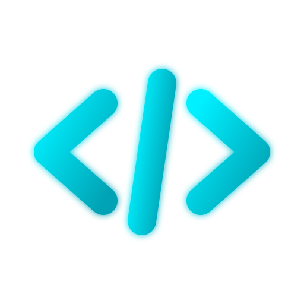

<div align="center">
  
  <h1>Daniel Quirós Barroso | Portfolio</h1>
  <p>🚀 Fullstack Developer & Especialista en Mecatrónica (IOT/Industrial)</p>
  <p>🌍 Don Benito, Badajoz, España</p>

  <p>
    <a href="https://linkedin.com/in/daniel-quiros-barroso" target="_blank">
      
    </a>
    <a href="mailto:daniqb99@icloud.com">
      
    </a>
  </p>
</div>

---

## 👋 Sobre Mí

Soy **Daniel Quirós Barroso**, un desarrollador enfocado en crear soluciones de software escalables y eficientes. Mi perfil combina una sólida base lógica y analítica, proveniente de mi formación en **Mecatrónica Industrial**, con el ingenio y la adaptación del **Desarrollo Fullstack**.

Me apasiona integrar nuevas tecnologías, como **Agentes de IA y Prompt Engineering**, para optimizar la calidad del código, potenciar la eficiencia operativa y llevar los proyectos al siguiente nivel.

---

## 💻 Tecnologías y Herramientas

### Frontend


### Backend & Base de Datos


### Herramientas y Otros


---

## 🌟 Sobre este Proyecto

Este repositorio contiene el código fuente de mi portfolio personal. No es solo una simple tarjeta de presentación, sino una **demostración técnica** de mis estándares de desarrollo:

- **Arquitectura Modular**: Construido con `React` utilizando componentes funcionales altamente reutilizables.
- **Diseño Moderno y Responsivo**: Implementado con `Tailwind CSS`, usando estrategias Mobile-First, paletas de colores coherentes, animaciones atractivas, y utilidades modernas como fondos con _blur_ y _glassmorphism_.
- **Dark/Light Mode Nativo**: Transiciones fluidas y adaptación perfecta a las preferencias del usuario.
- **Rendimiento**: Empaquetado optimizado mediante `Vite` para cargas instantáneas.

---

## 🛠️ Instalación y Uso Local

Si deseas clonar y revisar en detalle el código fuente, sigue estos pasos:

1. **Clona este repositorio**
   ```bash
   git clone https://github.com/DaniQB99/danidev.git
   ```
2. **Accede al directorio**
   ```bash
   cd danidev
   ```
3. **Instala las dependencias**
   ```bash
   npm install
   ```
4. **Inicia el entorno de desarrollo**
   ```bash
   npm run dev
   ```
5. Abre [http://localhost:5173](http://localhost:5173) en tu navegador preferido.

---

## 📫 Contacto

¿Tienes un proyecto interesante, buscas talento para tu equipo o te gustaría intercambiar ideas sobre IA y desarrollo?
**¡Hablemos!**

- **Email**: [daniqb99@icloud.com](mailto:daniqb99@icloud.com)
- **LinkedIn**: [Daniel Quirós Barroso](https://linkedin.com/in/daniel-quiros-barroso)
- **Ubicación**: Don Benito, Badajoz, España

<br />

<div align="center">
  <p><i>"Combinando la precisión de la ingeniería mecatrónica con la escalabilidad del desarrollo de software."</i></p>
  <p>⭐ Si este código te resulta de utilidad o inspiración, una estrella es muy apreciada.</p>
</div>
